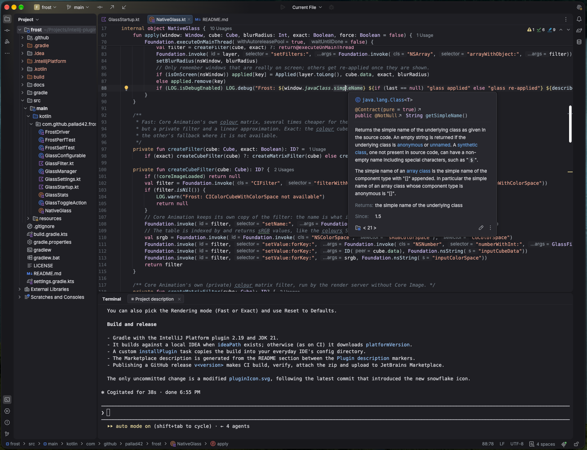

<p align="center">
  
</p>

<h1 align="center">Powder</h1>

<p align="center">
  <b>A calm dark theme for the Islands UI, inspired by Xcode.</b><br>
  Neutral graphite, powder pink keywords, soft pastel accents - and code that does not turn into confetti.
</p>

<p align="center">
  <a href="#install">Install</a> ·
  <a href="#palette">Palette</a> ·
  <a href="#font">Font</a> ·
  <a href="#faq">FAQ</a> ·
  <a href="#build">Build</a>
</p>

<p align="center">
  
  
  <a href="LICENSE"></a>
  
</p>

<!-- Screenshot goes here:
<p align="center">
  
</p>
-->

## Features

- **The whole Islands UI in graphite.** Tool windows, editor, popups, toolbars and dialogs are repainted in neutral
  graphite greys, with a soft system blue as the accent.
- **Quiet syntax colours.** Keywords, strings, numbers, function declarations, types, annotations and fields are
  coloured; calls get a lighter powder blue, static members are italic, operators and punctuation are dimmed,
  variables and parameters stay plain text. No bold, as in Xcode.
- **Every language.** The scheme colours the language defaults, which every language (PHP, JavaScript, TypeScript,
  Java, Kotlin, Dart, SQL, Python, Go, Ruby, CSS, HTML...) falls back to, so they all follow the same style - and your
  own changes to Language Defaults reach them too. Only the few elements that do not fall back get a colour of their
  own.
- **Terminal included.** Terminal and console colours come from the same palette.
- **Bundled font.** Bitstream Vera Sans Mono 13.5 with line height 1.1, applied once when you switch the theme on.
- **Pairs with [Frost](https://github.com/pallad42/frost-jetbrains)** for translucent, blurred IDE windows.

## Install

**From disk** (Powder is not on JetBrains Marketplace yet):

1. Download `powder-<version>.zip` from [Releases](https://github.com/pallad42/powder-jetbrains/releases), or build it
   with `./gradlew buildPlugin`.
2. <kbd>Settings</kbd> → <kbd>Plugins</kbd> → <kbd>⚙</kbd> → <kbd>Install Plugin from Disk…</kbd>
3. <kbd>Settings</kbd> → <kbd>Appearance & Behavior</kbd> → <kbd>Appearance</kbd> → <kbd>Theme</kbd> → **Powder**.

The editor colour scheme switches to **Powder** together with the theme.

## Palette

| Colour | Used for |
|---|---|
| `#1f1f24` | editor, tool windows, terminal |
| `#18181c` | window frame |
| `#28282e` | popups |
| `#d9d9de` | text, variables, parameters |
| `#d895b4` | keywords |
| `#e3a08c` | strings |
| `#d2c283` | numbers, constants |
| `#8fb3c9` | function declarations, keys in JSON / YAML / CSS, HTML / XML attributes |
| `#b5c8d5` | function and method calls |
| `#a5acb4` | operators, braces, commas, dots |
| `#c3b4e8` | classes, types, HTML / XML tags |
| `#c29a74` | annotations, PHP attributes |
| `#a5cdb9` | fields and properties |
| `#6f7a85` | comments (italic) |
| `#6aa6e8` | UI accent, links |
| `#414a5c` | selection |

## Font

Powder comes with **Bitstream Vera Sans Mono**. The first time you switch the theme on, it sets:

| Where | Font | Size | Line height |
|---|---|---|---|
| Editor (<kbd>Settings</kbd> → <kbd>Editor</kbd> → <kbd>Font</kbd>) | Bitstream Vera Sans Mono | 13.5 | 1.1 |
| Terminal (<kbd>Settings</kbd> → <kbd>Tools</kbd> → <kbd>Terminal</kbd>) | Bitstream Vera Sans Mono | 13.5 | 1.1 |

It also turns off the terminal's minimum contrast adjustment, so the terminal shows the palette's colours as they
are. This happens **only once**: change any of it afterwards and Powder leaves it alone.

## FAQ

<details>
<summary><b>I switched the theme but the font did not change.</b></summary>

The font is applied only the first time Powder is switched on. If you had used the theme before, set it yourself in
<kbd>Settings</kbd> → <kbd>Editor</kbd> → <kbd>Font</kbd> and <kbd>Settings</kbd> → <kbd>Tools</kbd> →
<kbd>Terminal</kbd>.
</details>

<details>
<summary><b>Can I use the colours without the font?</b></summary>

Yes. Pick any font afterwards - the theme and the colour scheme do not depend on it.
</details>

<details>
<summary><b>How do I get translucent, blurred windows?</b></summary>

Install [Frost](https://github.com/pallad42/frost-jetbrains) next to Powder (macOS only for now).
</details>

<details>
<summary><b>Why does the plugin use internal IntelliJ API?</b></summary>

There is no public API to set the editor's fractional font size or the terminal's font. Powder only uses it once,
when the theme is first switched on, and guards the call: if a future IDE changes it, the theme still works, only
the font is not set automatically.
</details>

## Build

```
./gradlew buildPlugin       # build/distributions/powder-<version>.zip
./gradlew runIde            # sandbox IDE with the plugin
./gradlew runIdeWithFrost   # the same, with Frost installed too (build ../frost first)
./gradlew installPlugin     # install into your IntelliJ IDEA (close it first; see ideaConfigDir)
./gradlew verifyPlugin      # compatibility check (Plugin Verifier)
```

Builds against the IntelliJ IDEA at `ideaPath` in `gradle.properties` when it exists, otherwise downloads
`platformVersion` (that is what CI does). Gradle provisions JDK 21 automatically.

### Changing the colours

The theme (`src/main/resources/themes/Powder.theme.json`) and the colour scheme (`Powder.xml`) are generated -
edit the palette and the syntax rules in `scripts/generate_theme.py` (the language keys and their roles are in
`scripts/language_keys.tsv`) and run:

```
python3 scripts/generate_theme.py ["/Applications/IntelliJ IDEA.app"]
```

The script reads the bundled Islands Dark theme, IntelliJ Dark and Darcula colour schemes and the colour additions of
bundled plugins from an installed IntelliJ IDEA and repaints them, so run it again after an IDE update.

The language keys every language falls back from are listed in `scripts/fallback_keys.tsv`. After an IDE update, or
to cover another language plugin (installed, or a zip downloaded from JetBrains Marketplace), refresh the list and
then run `generate_theme.py` again:

```
python3 scripts/read_language_keys.py ["/Applications/IntelliJ IDEA.app"] [plugin.zip ...]
```

It needs `javap` from a JDK, and lists any keys that still need a role in `language_keys.tsv`.

### Releasing

1. Bump `version` in `build.gradle.kts` and the change notes in `plugin.xml`, push.
2. Publish a GitHub release tagged `v<version>`. CI builds and verifies the plugin, attaches the zip to the release
   and uploads it to JetBrains Marketplace (needs the `PUBLISH_TOKEN` repository secret).

## Credits

- Colours inspired by Xcode's Default (Dark) theme; UI built on JetBrains' Islands Dark theme.
- Bitstream Vera Sans Mono, Copyright (c) 2003 Bitstream, Inc. - see
  [VERA-COPYRIGHT.txt](src/main/resources/fonts/VERA-COPYRIGHT.txt) for its license.
- Built with the help of Claude (Anthropic).

## License

MIT - see [LICENSE](LICENSE). The bundled Bitstream Vera fonts are under their own license (see above).
